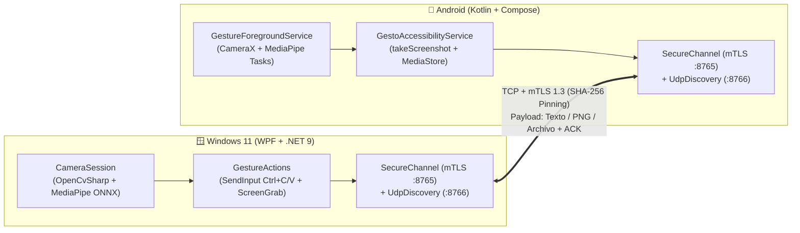

<div align="center">

# ✋✊ GestoClip

**Portapapeles Universal y Transferencia Instantánea por Gestos en el Aire (`Windows 11 ⇄ Android`)**

[](https://github.com/Jovani-esj/GestoClip/releases/latest)
[-3DDC84?style=for-the-badge&logo=android&logoColor=white)](https://github.com/Jovani-esj/GestoClip/releases/latest)
[](#%EF%B8%8F-arquitectura-y-seguridad-lan)
[](./LICENSE)

<p align="center">
  <b>Copia texto, imágenes o capturas de pantalla en un dispositivo cerrando el puño frente a la cámara (<code>PALM → FIST</code>) y pégalos en el otro abriendo la palma (<code>FIST → PALM</code>).</b><br/>
  100 % en red local (LAN) • Cero servidores en la nube • Cámara bajo demanda
</p>

---

### 📥 Descargar Instaladores Directos (Listos para Usar)

| Plataforma | Archivo de Instalación | Tamaño | Descripción |
| :--- | :--- | :--- | :--- |
| 🪟 **Windows 10 / 11 (x64)** | [**⬇️ Descargar `GestoClip-Setup.exe`**](https://github.com/Jovani-esj/GestoClip/raw/main/releases/GestoClip-Setup.exe) | ~98.8 MB | Instalador gráfico autocontenido (no requiere instalar .NET ni librerías adicionales). Crea accesos directos, desinstalador y arranque opcional con Windows. |
| 🤖 **Android 9.0+ (ARM64/x86)** | [**⬇️ Descargar `GestoClip-Android.apk`**](https://github.com/Jovani-esj/GestoClip/raw/main/releases/GestoClip-Android.apk) | ~92.5 MB | Aplicación nativa con soporte para Botón Flotante, Quick Settings Tile, lectura de QR y capturas directas por Accesibilidad. |

</div>

---

## 🎯 ¿Qué es GestoClip y qué problema resuelve?

Pasar un fragmento de texto, una imagen recortada o una captura de pantalla entre la PC y el teléfono suele obligarte a enviarte mensajes a ti mismo por WhatsApp/Telegram o subir archivos a la nube.

**GestoClip** convierte un gesto natural de la mano en un puente directo entre tus dispositivos dentro de la misma red Wi-Fi/LAN:

1. **Cerrar el puño (`PALM → FIST` — "Agarrar")**:
   - En **Windows**: Copia automáticamente el texto o imagen que tengas seleccionado (`Ctrl+C` sintético). Si no seleccionaste nada nuevo, toma una **captura de pantalla completa** al instante y la envía a tu Android.
   - En **Android**: Lee tu portapapeles actual o, si está vacío/sin cambios, toma una **captura de pantalla nativa** (vía *AccessibilityService*, sin el molesto diálogo de confirmación de *MediaProjection*) y la envía a tu PC.
2. **Abrir la palma (`FIST → PALM` — "Soltar")**:
   - Coloca el paquete recibido en el portapapeles del dispositivo destino, simula `Ctrl+V` en la ventana activa (Windows) o guarda la imagen automáticamente en la galería **`Pictures/GestoClip`** (Android).

---

## ✨ Características Principales

- 🔒 **Privacidad de Cámara Total (On-Demand)**:
  - La cámara web o frontal **jamás** permanece encendida en segundo plano.
  - Solo se activa durante una ventana configurable de **6 segundos** cuando tú lo pides: presionando **`Ctrl + Alt + G`** en Windows o tocando la **burbuja flotante / mosaico de ajustes rápidos** en Android. En cuanto se detecta el gesto, la cámara se apaga de inmediato.
- ⚡ **Detección Neuronal de 21 Puntos en Tiempo Real**:
  - **Windows**: Pipeline nativo en C# con `OpenCvSharp4` y modelos ONNX de **MediaPipe** (`palm_detection` + `handpose_estimation`), con vista en vivo del esqueleto de 21 articulaciones de la mano.
  - **Android**: Pipeline con `CameraX` y `MediaPipe Tasks Vision` (`gesture_recognizer.task`) acelerado en el dispositivo.
- 🛡️ **Cifrado Mutuo TLS (mTLS) y Emparejamiento por QR**:
  - Descubrimiento automático en red local mediante balizas UDP Broadcast (`puerto 8766`).
  - Transporte directo por TCP + **TLS 1.3 / 1.2 mutuo** (`puerto 8765`) con certificados X.509 ECDSA P-256 autofirmados y fijación criptográfica de huella SHA-256 (*certificate pinning*).
  - Emparejamiento mediante **Código QR** con token de un solo uso de 6 dígitos, expiración de 120 segundos y bloqueo automático tras 3 intentos fallidos.
- 🎨 **Interfaz Moderna Nativa**:
  - **Windows 11**: Interfaz *Fluent Dark* completa con 4 secciones (Gestos y Cámara en Vivo, Emparejar por QR, Dispositivos en Red y Ajustes), además de integración en la bandeja del sistema (*System Tray*).
  - **Android**: Interfaz oscura en *Jetpack Compose* con asistente de permisos paso a paso, escáner QR con cámara en vivo (`ZXing`) y generador QR propio.

---

## 🚀 Guía de Instalación y Uso Rápido para Usuarios

### 1️⃣ Instalación en Windows 11
1. Descarga [**`GestoClip-Setup.exe`**](https://github.com/Jovani-esj/GestoClip/raw/main/releases/GestoClip-Setup.exe) directamente desde este repositorio (o desde la carpeta [`releases/`](./releases)).
2. Ejecuta el instalador, elige tus opciones (acceso directo en Escritorio e iniciar junto con Windows) y haz clic en **Instalar ahora**.
3. Al abrir **GestoClip**, ve a la pestaña **🔗 Emparejar por QR** para mostrar el código QR de vinculación en pantalla.

### 2️⃣ Instalación en Android
1. Descarga [**`GestoClip-Android.apk`**](https://github.com/Jovani-esj/GestoClip/raw/main/releases/GestoClip-Android.apk) en tu teléfono e instálalo.
2. En la pantalla principal de **GestoClip Android**, concede los 3 permisos guiados:
   - **Cámara y Notificaciones** (para detectar gestos bajo demanda y escanear el QR).
   - **Superposición (Botón flotante)** (para tener el disparador rápido sobre cualquier app).
   - **Servicio de Accesibilidad de GestoClip** (para tomar capturas de pantalla limpias sin diálogos del sistema al cerrar el puño).
3. Toca **«Escanear QR de PC»**, apunta al código QR de tu pantalla de Windows y ¡listo! Ambos dispositivos quedarán emparejados de forma permanente y segura.

### 3️⃣ Cómo transferir con gestos
1. Activa la ventana de escucha:
   - En **Windows**: Presiona **`Ctrl + Alt + G`** (o el botón *Probar Gesto Ahora* en la app).
   - En **Android**: Toca la **burbuja flotante** o el mosaico **GestoClip** en tu barra de notificaciones.
2. **Para enviar**: Muestra tu **palma abierta** medio segundo y **cierra el puño** (`✋ → ✊`). Escucharás/verás la confirmación de envío.
3. **Para recibir/pegar**: Activa la escucha en el otro dispositivo, muestra el **puño cerrado** y **abre la palma** (`✊ → ✋`).

---

## 🏗️ Arquitectura del Proyecto



### Estructura de Directorios

```text
GestoClip/
├── gestoclip-windows/               # Solución nativa de Windows 11 (.NET 9)
│   ├── GestoClip.Core/              # Protocolo binario, mTLS, UDP Discovery, QR Pairing y Máquina de Estados
│   ├── GestoClip.Vision/            # Inferencia ONNX (BlazePalm + HandPose 21 pts) y captura de cámara
│   ├── GestoClip.App/               # Interfaz gráfica WPF Windows 11 Fluent Dark + System Tray + Win32 APIs
│   ├── GestoClip.Installer/         # Instalador gráfico autocontenido (genera GestoClip-Setup.exe)
│   └── GestoClip.Tests/             # Suite de 23 pruebas unitarias e integración (xUnit)
│
└── gestoclip-android/               # Proyecto nativo de Android (Kotlin / Gradle)
    └── app/src/main/java/com/gestoclip/
        ├── protocol/                # Serialización binaria (Big-Endian) compatible byte a byte con Windows
        ├── net/                     # mTLS con BouncyCastle X.509, UdpDiscovery y PairingManager
        ├── vision/                  # CameraX + MediaPipe HandGestureDetector + ForegroundService
        ├── access/                  # GestoAccessibilityService (captura nativa Android 9/11+)
        ├── storage/                 # Guardado automático en galería (MediaStore Pictures/GestoClip)
        └── ui/                      # MainActivity (Compose), FloatingButtonService y QuickTileService
```

---

## 🛠️ Compilación desde el Código Fuente

### Requisitos en Windows
- **.NET 9.0 SDK**
- Windows 10 o Windows 11 (x64)

```powershell
cd gestoclip-windows

# Ejecutar las 23 pruebas automatizadas (protocolo, visión ONNX, mTLS y emparejamiento QR)
dotnet test GestoClip.sln

# Compilar y ejecutar la aplicación de escritorio
dotnet run --project GestoClip.App/GestoClip.App.csproj
```

### Requisitos en Android
- **JDK 17**
- **Android SDK (API 35)**

```powershell
cd gestoclip-android

# Ejecutar pruebas unitarias y generar el APK
.\gradlew.bat testDebugUnitTest assembleDebug
```

---

## 📜 Licencia (Software Libre No Comercial)

Este proyecto está protegido bajo la licencia **[PolyForm Noncommercial License 1.0.0](./LICENSE)**.

- ✅ **Permitido**: Uso personal, educativo, académico, de investigación, auditoría de código, modificación y redistribución gratuita sin fines de lucro.
- ❌ **Prohibido**: Venta del software, integración en productos comerciales o prestación de servicios de pago basados en GestoClip sin autorización escrita del autor.

> 💡 *¿Necesitas integrarlo en un proyecto bajo licencia de Software Libre estricto de la FSF?* El autor también permite el uso bajo **GNU AGPLv3** para proyectos comunitarios de código abierto que mantengan la misma libertad y atribución.
